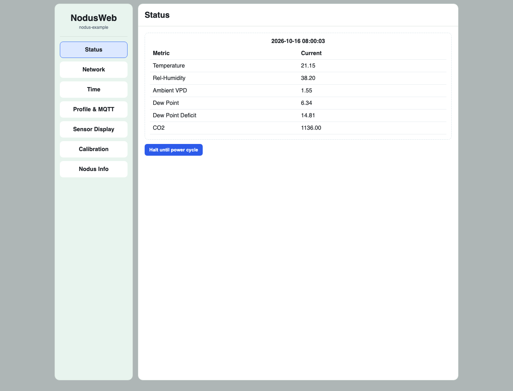

# cPyNodus_II

**Learn connected embedded systems by building a working sensor and controller.**

cPyNodus II is a CircuitPython project for makers, students, and educators with
basic Python and electronics experience who want to explore Raspberry Pi Pico 2 W
and Seeed Studio XIAO ESP32-S3 Sense microcontrollers. Work with sensors, Wi-Fi,
local web interfaces, MQTT, automation, and recovery from failures in a working
firmware system.

A device running the firmware is called a **Nodus**. It can operate as a sensor,
a switch, or a combined sensor-and-switch node. Start with its local NodusWeb
interface, then explore integrations with Sensorius, Home Assistant, or WeeWX.

The [13-lesson series](docs/syllabus-lessons/README.md) takes a guided Pico 2 W
build from tool setup and wiring to a tested extension project.



## Project status

The firmware is under active development and is intended for hobbyist,
educational, and experimental IoT deployments. Configuration keys, MQTT
contracts, and internal architecture may change as the software matures.

The supported boards and core runtime paths have been tested on physical
hardware. Host-side tests supplement, but do not replace, on-device validation.

## Supported hardware

| Target | Board | Verified CircuitPython |
| --- | --- | --- |
| `pico2w` | Raspberry Pi Pico 2 W | `9.2.8` |
| `xesp32s3` | Seeed Studio XIAO ESP32-S3 Sense | `10.2.1` |

The original RP2040 Raspberry Pi Pico W is not supported.

Nodus supports optional I2C environmental sensors, UART/Modbus soil sensors,
and up to two configured relay channels. See the [pinout guide](docs/pinout.md)
for the current board mappings.

## Choose your learning path

| Your goal | Start here | What to expect |
| --- | --- | --- |
| Build and learn with Pico 2 W | [Guided lesson series](docs/syllabus-lessons/README.md) | A complete sequence using a BME280 sensor and S1 output, from wiring and deployment through MQTT, recovery, testing, and extension work. |
| Explore XIAO ESP32-S3 Sense | [XIAO bring-up guide](docs/xiao_esp32s3_circuitpython_bringup.md), [pinouts](docs/pinout.md), and [technical reference](docs/README.md) | A supported firmware target with board-specific setup; the Pico lessons treat adapting the fixture to XIAO as extra credit rather than providing a parallel tutorial. |
| Teach a class or workshop | [Lesson index and outcomes](docs/syllabus-lessons/README.md) | Lessons include prerequisites, time estimates, acceptance criteria, debugging guidance, and reference observations; the extension project includes a rubric. |
| Use an already prepared device | [User guide](docs/user_guide.md) | AP setup, local web pages, profiles, calibration, switches, and automations. |

### Before you start

- Know basic Python functions, classes, exceptions, and modules, plus basic
  low-voltage wiring and breadboard use. Previous CircuitPython or MQTT setup
  is not required for the guided lessons.
- The documented course toolchain uses **Linux or macOS**. Host exercises use
  Python 3.11 or later; firmware runs on the board's verified CircuitPython
  version from the table above.
- For the Pico course fixture, prepare a Pico 2 W with headers, USB data cable,
  breadboard, jumpers, a 3.3 V-compatible BME280 configurable to I2C address
  `0x76`, the RW mode selector, and the S1 enable/output components. See
  [Lesson 2](docs/syllabus-lessons/02-pico2w-hardware.md) for the complete wiring
  and parts requirements. An LED is the first S1 output fixture.
- Compiled deployment requires a host-compatible `mpy-cross` matching the
  target CircuitPython version and a compatible MPY library bundle. The build
  script's default library paths refer to the maintainer's local directory
  layout. Independent learners must supply their own paths; instructors should
  prepare tested compiler and bundle inputs before class. See
  [Lesson 1](docs/syllabus-lessons/01-development-toolchain.md).

### Your first working device

Begin with the **Pico 2 W guided path** and the `nodusweb` profile, which needs
no MQTT broker. Follow Lessons 1–4 in order: prepare the tools, wire the fixture,
install CircuitPython and check it through the REPL, then deploy and provision
Nodus. Their combined estimates are about **5–6.5 hours**, plus downloads and
troubleshooting; plan multiple sessions if needed.

Your first visible milestone is a NodusWeb status page showing BME280 temperature,
humidity, pressure, and a sample timestamp. Confirm a subsequent sample before
continuing to the S1 output exercise. Later lessons connect these observations
to the source code, MQTT, automation, constrained memory, and recovery behavior.

Without hardware, you can work through the source-reading and host exercises;
record physical behavior as unverified. Educators can use the lesson outcomes
and acceptance criteria to select follow-on labs after the foundational setup.

## Build and deploy overview

This is a summary for readers who have prepared the tools and wiring. Use
[Lessons 1–4](docs/syllabus-lessons/README.md) for the complete Pico instructions,
or the XIAO references above for that board's setup.

1. Install the verified CircuitPython version for your board. Installing the
   interpreter and copying the Nodus application are separate steps.
2. Clone the repository and enter its directory:

   ```bash
   git clone https://github.com/mot-yelraf/cPyNodus_II.git
   cd cPyNodus_II
   ```

3. Build for **one target** using your matching compiler and library bundle.
   Replace the example paths with actual extracted paths:

   ```bash
   # Pico 2 W: CircuitPython 9.2.8 compiler and compatible 9.x MPY bundle
   bash scripts/nodus_mpy.sh --target pico2w \
     --compiler "/absolute/path/to/9.2.8/mpy-cross" \
     --lib-source "/absolute/path/to/9.x-bundle/lib"
   ```

   ```bash
   # XIAO ESP32-S3 Sense: CircuitPython 10.2.1 compiler and compatible 10.x MPY bundle
   bash scripts/nodus_mpy.sh --target xesp32s3 \
     --compiler "/absolute/path/to/10.2.1/mpy-cross" \
     --lib-source "/absolute/path/to/10.x-bundle/lib"
   ```

   Both targets require MPY v6.3 output. Keep the interpreter, compiler,
   application artifacts, and libraries matched to the selected target.

4. Select host-edit mode and confirm the actual mounted `CIRCUITPY` drive.
   Preview deployment, then repeat without `--dry-run` to copy:

   ```bash
   # macOS mount example; substitute the actual path on your computer
   bash scripts/deploy_nodus.sh --target /Volumes/CIRCUITPY \
     --content pico2w-mpy --dry-run
   ```

   Use `--content xesp32s3-mpy` for XIAO. Build immediately before deployment:
   an automatic stale-artifact rebuild uses default library lookup rather
   than forwarding the custom `--lib-source` from your earlier build.

5. Safely finish copying, power off, select application-write mode with the
   board's RW selector, and power on. First bootstrap needs application-write
   access to create the detected hardware's live TOML configuration files.
   The selector is GP14 on Pico 2 W and D8 on XIAO; see the
   [pinout guide](docs/pinout.md). In application-write mode the USB drive is
   intentionally hidden, while serial access remains available.
6. Join the device's setup AP, normally `Nodus-<suffix>` with factory password
   `password`, and open `http://192.168.4.1:8000/setup`. Follow the
   [user guide](docs/user_guide.md) to save Wi-Fi settings and select `nodusweb`
   for the first local exercise. After restart, reconnect your computer to
   the normal network and open the device's reported IP address or hostname.

## Share your learning experience

Feedback from a first attempt is useful even if you never finish the setup or
change the code. Tell us:

- Which board, host operating system, and lesson or guide did you try?
- What was the last step you completed successfully?
- Where did you hesitate, get stuck, or stop?
- What explanation, example, or teaching material would have helped?

For a documentation or lesson improvement, use the
[feature request form](https://github.com/mot-yelraf/cPyNodus_II/issues/new?template=feature_request.yml)
and select **Documentation** as the area. Describe the confusing step under
Problem and your suggested clarification under Proposed solution; if you do
not know the solution, say what you needed to understand or accomplish.
For a reproducible malfunction, use the
[bug report form](https://github.com/mot-yelraf/cPyNodus_II/issues/new?template=bug_report.yml).
Remove credentials and private information from any evidence you share.

Educators: feedback on preparation time, prerequisite knowledge, lesson scope,
and suitability for your class or workshop is especially welcome.

## Features

- Sensor-only, switch-only, and combined sensor-plus-switch configurations
- First-boot hardware detection and TOML configuration generation
- Wi-Fi station startup with AP fallback for setup and network recovery
- Lightweight NodusWeb status, setup, calibration, switch, and automation pages
- MQTT telemetry, retained state, availability, configuration, and calibration
- Sensorius onboarding and device-management contracts
- Home Assistant MQTT discovery
- WeeWX 5 integration and Nodus report skin
- NodusWeb-local sensor, time, timer, and AND/OR switch automations
- Bounded recovery and reboot diagnostics on writable filesystems
- Target-specific compiled MPY firmware builds
- Signed OTA preparation, authenticated chunked HTTP transfer, verification,
  transactional apply, and rollback support

## Runtime profiles

| Profile | Purpose |
| --- | --- |
| `nodusweb` | Local web UI and API without an MQTT broker; supports local switch automations |
| `sensorius` | Headless MQTT operation managed by Sensorius |
| `homeassistant` | Headless MQTT operation with Home Assistant discovery |
| `weewx` | Headless MQTT publishing for the included WeeWX integration |

AP mode remains available for initial setup and network recovery. Normal
runtime web pages are intentionally disabled for the headless MQTT profiles.

## WeeWX host setup

On the Debian or Raspberry Pi OS host that will run WeeWX 5, run the entry
point in `scripts/` from the repository root:

```bash
./scripts/setup_nodus_weewx_host.sh
```

You can also run it from inside `scripts/`:

```bash
cd scripts
./setup_nodus_weewx_host.sh
```

It delegates to the canonical installer under `integrations/weewx/` and
installs the independent Nodus WeeWX service, report skin, extensions, device
manager, and full-screen Nodus AI Graphum for archived sensor and switch
history. Start with the [WeeWX installation
runbook](docs/weewx_install.md).

## Configuration and integration documentation

- [User guide](docs/user_guide.md)
- [Technical reference](docs/README.md)
- [Configuration files and keys](docs/configuration.md)
- [Architecture](docs/architecture.md)
- [Board pinouts](docs/pinout.md)
- [MQTT overview](docs/mqtt.md)
- [Sensorius contract](docs/sensorius_contract.md)
- [NodusWeb automations](docs/automations.md)
- [Over-the-air updates](docs/ota.md)
- [WeeWX installation runbook](docs/weewx_install.md)
- [Detailed WeeWX integration](docs/weewx.md)
- [Extending sensors and switches](docs/extending.md)

## Security

Nodus is intended for trusted-network, hobbyist, and educational deployments.
Credentials written by onboarding are obfuscated rather than encrypted, and
the firmware is not hardened against physical access to the CircuitPython
filesystem. Review the [security policy](docs/SECURITY.md) before deployment
in any environment where credential or device access would be consequential.
OTA packages are authenticated with a device-held public key, but their
temporary HTTP transport is not confidential.

Report suspected vulnerabilities privately using the process in the security
policy rather than opening a public issue.

## Development and testing

Host-side verification uses Ruff and pytest:

```bash
ruff check .
pytest -q
```

These checks run under CPython and do not execute the firmware on a
CircuitPython board. Changes involving hardware, Wi-Fi, MQTT, recovery, OTA,
filesystem behavior, or relay operation require relevant on-device validation.
MQTT validation requires broker-visible evidence; serial output alone is not
proof that a publish reached the broker.

Read [CONTRIBUTING.md](docs/CONTRIBUTING.md) before proposing changes. The
project's stability-sensitive areas and hardware-verification expectations are
documented there.

## License

This project is licensed under the [BSD 2-Clause License](LICENSE).

## Acknowledgments

`cPyNodus_II` builds on work from the earlier `cPyNodus` project. Development
included AI-agent assistance, followed by substantial human-directed testing,
hardware validation, and revision to achieve the current device behavior.

- System Architecture: TW Farley
- Implementation and Coding: TW Farley and ChatGPT/Codex
